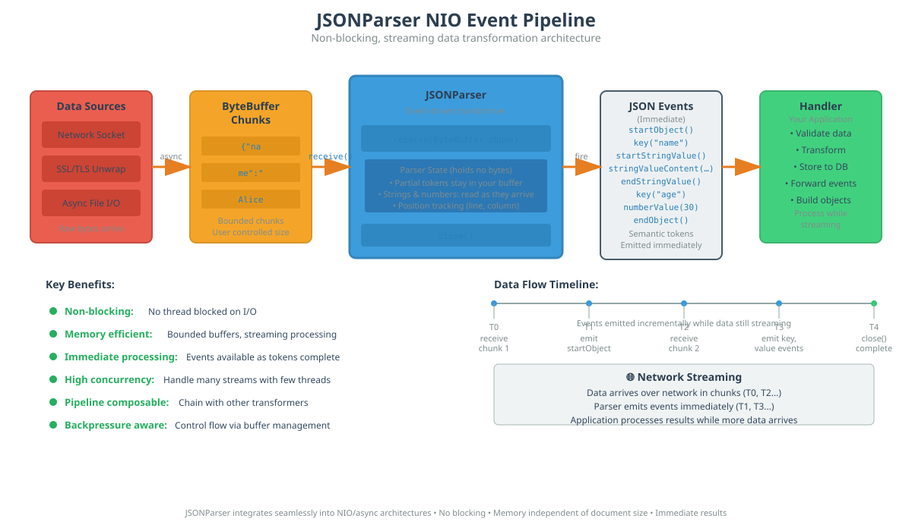
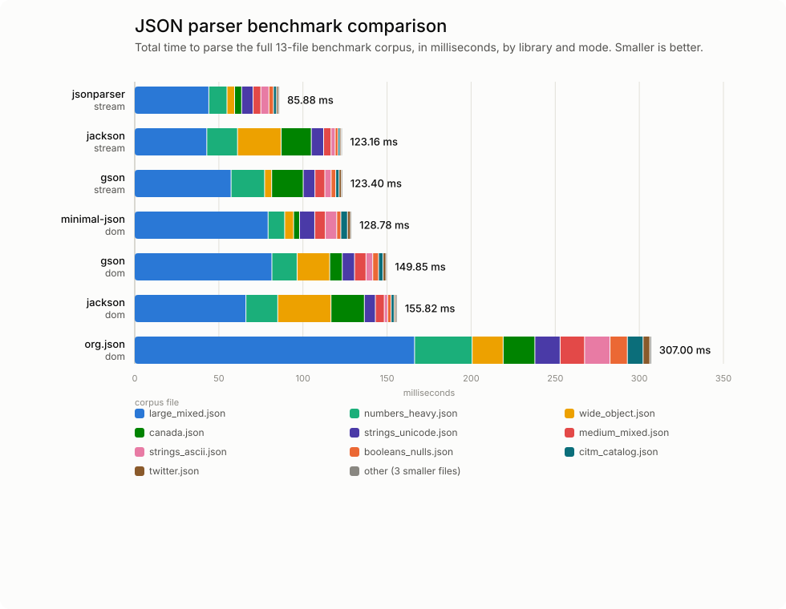

# jsonparser
JSON parser and serializer for Java

This is a tiny and efficient JSON parser and serialization library for
Java. It takes up only 31KB (including the serialisation feature), as
opposed to object-mapping-based JSON parsers such as GSON (306KB) or
Jackson (580KB for streaming alone, 2.3MB with object-mapping/databind
support), and is fast and conformant. The streaming parser's memory use
does not grow with document size, but it does grow with the size of the
largest single string value or key, which is buffered until complete (see
[Memory behaviour](#memory-behaviour)).

Full JavaDoc documentation is included in the package, see the doc
subdirectory.

**[View API documentation online](https://cpkb-bluezoo.github.io/jsonparser/doc/)

## Parser

### Asynchronous, Non-Blocking API (Primary)

The `JSONParser` is designed as an **asynchronous-first, non-blocking,
data-driven parser** that integrates seamlessly into event-driven
architectures. Instead of blocking on I/O operations, it uses a **push
model** where you feed bytes to the parser as they arrive from any
source — network sockets, async file I/O, message queues, or any
streaming data pipeline.



This design makes the parser ideal for:
- **Non-blocking I/O** systems (NIO, async frameworks)
- **Event-driven architectures** (reactive streams, actors)
- **High-concurrency servers** where blocking is prohibitive
- **Data pipeline architectures** where JSON transformation is one stage
- **Memory-constrained environments** — memory use independent of document
  size (bounded by the largest string, see [Memory behaviour](#memory-behaviour))

Traditional object-mapping based JSON parsers such as GSON or Jackson, in
contrast, are **blocking** — your application thread has to block while
it processes the entire message. If the message hasn't been completely
delivered yet, your entire process has to wait. Then when it finally
produces the parse result, that result is an object taking up memory
proportional to the size of the JSON message.

With this event-based parser, memory usage does not depend on how large
the JSON document is: only your buffer, plus the parser's carry-over of
the one token currently being assembled (see
[Memory behaviour](#memory-behaviour) for what that means for large
strings). JSON semantic events are delivered before the parse is complete,
even before the message has finished arriving over the network: low
latency, and zero-copy for any token that arrives within a single chunk.

#### How It Works

The parser maintains internal state between calls and emits parsing events
via the SAX-like `JSONContentHandler` interface as soon as complete tokens
are recognized. This allows it to operate as a **streaming transformer** in
a data pipeline, converting raw byte chunks into semantic JSON events.

When a key or literal, or the start of an escape sequence or multi-byte
character inside a string, spans chunk boundaries, the parser copies the
incomplete bytes into an internal `pending` buffer and prepends them to the
next chunk. Strings and numbers never wait: they are read as they arrive. `receive()` therefore always consumes the whole buffer you pass
it; calling `compact()` afterwards is harmless but not required. Tokens
that arrive within a single chunk are tokenized in place with no copy.

**Core Methods:**
- `receive(ByteBuffer data)` - Push a chunk of bytes into the parser
- `close()` - Signal end of input and validate document completeness

**Buffer Contract:**
- Provide the buffer in read mode (after `flip()`)
- After `receive()` returns, `buffer.position()` indicates unconsumed data
- If `position() < limit()`, call `compact()` before reading more data
- This zero-copy design minimizes allocations and GC pressure

#### Async Streaming Example (NIO Channel)

```java
import java.nio.*;
import java.nio.channels.*;
import org.bluezoo.json.*;

public class AsyncJSONProcessor extends JSONDefaultHandler {
    
    @Override
    public void key(String key) throws JSONException {
        System.out.println("Key: " + key);
    }
    
    @Override
    public void startStringValue() throws JSONException {
        System.out.print("String: ");
    }

    @Override
    public void stringValueContent(CharSequence content) throws JSONException {
        // Only valid during this call: print it, or copy it with toString()
        System.out.print(content);
    }

    @Override
    public void endStringValue() throws JSONException {
        System.out.println();
    }
    
    public static void processChannel(ReadableByteChannel channel) 
            throws Exception {
        JSONParser parser = new JSONParser();
        parser.setContentHandler(new AsyncJSONProcessor());
        
        ByteBuffer buffer = ByteBuffer.allocate(8192);
        
        while (channel.read(buffer) != -1) {
            buffer.flip();              // Switch to read mode
            parser.receive(buffer);     // Parse available data
            buffer.compact();           // Preserve unconsumed bytes
        }
        
        // Process any remaining data
        buffer.flip();
        if (buffer.hasRemaining()) {
            parser.receive(buffer);
        }
        
        parser.close();  // Validate document completeness
    }
}
```

The `compact()` / `flip()` cycle ensures that partial tokens spanning chunk
boundaries are preserved and completed when more data arrives. This pattern
is standard for NIO and works naturally with non-blocking channels,
selectors, and async I/O frameworks.

This non-blocking approach means your application can:
- Process JSON data as it arrives without waiting for complete documents
- Integrate with async I/O frameworks (Netty, Vert.x, etc.)
- Build reactive data pipelines where JSON parsing is a transformation stage
- Handle multiple concurrent JSON streams without thread-per-connection
- Process arbitrarily large documents with memory independent of document
  size (subject to the string-length caveat in
  [Memory behaviour](#memory-behaviour))

### Memory behaviour

Memory use does not depend on the size of the document, or on the length of
any string value in it.

- **String values are streamed.** A string is reported as
  `startStringValue()`, any number of `stringValueContent(CharSequence)`
  calls, then `endStringValue()`, as the bytes arrive. The parser decodes
  into a character buffer of the same capacity as the byte buffer you pass
  to `receive()` and hands it to your handler, so a 1GB string costs the
  same as a 10 byte one. The content is only valid during the call because
  the buffer is reused: copy it (for example `toString()`) if you need to
  keep it, and treat it as provisional until `endStringValue()`, since a
  malformed string is only detected when it is reached.
- **Keys are single tokens.** `key(String)` takes a complete name, so a key
  that spans chunks is held in the internal `pending` buffer until its
  closing quote arrives. Keys are limited to `setMaxNameLength` bytes
  (default 4096), so keep your receive buffer larger than that. Literals
  (`true`, `false`, `null`) are held the same way, and are tiny.
- **Numbers are read a byte at a time** into a handful of counters, so a
  number can span any number of chunks without being held. A number has no
  closing delimiter, so it is reported when the next byte shows it has
  ended; a number that is the very end of the document (the whole document
  `42`) is reported by `close()`. `setMaxNumberLength` (default 1000) still
  limits how long one can be. Integers are always exact (a `BigInteger`
  beyond a `long`). A real number with more than 19 significant digits is
  converted using 19 of them, which gives the same double as
  `Double.parseDouble` except when a rounding boundary falls inside the
  digits dropped (roughly 1 in a few hundred to a few thousand such
  numbers), when it can be one unit in the last place out. Real numbers with
  19 or fewer significant digits are always exactly rounded.
- Nesting costs a little per open array or object (`setMaxNestingDepth`,
  default 1000). The key-interning table holds at most 10,000 distinct keys.
  `setRejectDuplicateKeys(true)` remembers every key of every open object,
  so it is proportional to the document and is off by default.

If your handler assembles strings itself (for example into a
`StringBuilder`), that memory is yours, and is exactly as large as the
strings you choose to keep.

### Traditional Blocking API (Convenience)

For simpler use cases where blocking I/O is acceptable, a traditional
`parse(InputStream)` method is provided as a convenience wrapper. It
internally delegates to the streaming API by reading the stream in
chunks.

#### Blocking Example

```java
import java.io.*;
import org.bluezoo.json.*;

public class ListFieldNames extends JSONDefaultHandler {
    
    public void key(String key) throws JSONException {
        System.out.println(key);
    }
    
    public static void main(String[] args) throws Exception {
        InputStream in = null;
        try {
            in = new FileInputStream(args[0]);
            JSONParser parser = new JSONParser();
            parser.setContentHandler(new ListFieldNames());
            parser.parse(in);  // Convenience method - blocks until complete
        } finally {
            in.close();
        }
    }
}
```

### Event-Driven Design

The parser follows the same event-driven pattern as the SAX API for
parsing XML. You create an implementation of the `JSONContentHandler`
interface to receive parsing events. There is a handy
`JSONDefaultHandler` class that you can subclass if you only want to
implement a subset of the methods.

Your handler will be notified of events in the JSON stream as they are
recognized:
- `startObject()` / `endObject()` - Object boundaries
- `startArray()` / `endArray()` - Array boundaries  
- `key(String)` - Object field names
- `startStringValue()` / `stringValueContent(CharSequence)` /
  `endStringValue()` - String values, delivered as they arrive (see below)
- `numberValue(Number)` - Numeric values
- `booleanValue(boolean)` - Boolean values
- `nullValue()` - Null values
- `whitespace(String)` - Whitespace (if needed for pretty-printing)

This event-driven model allows you to build custom JSON processors
without materializing the entire document in memory—perfect for
processing large JSON streams or building transformation pipelines.

## Serializer

The serializer follows the same pattern as the javax.xml.stream API for
writing XML. You create an instance of `JSONWriter` that wraps a
`WritableByteChannel` or `OutputStream`. You then call the JSON value
construction methods, in order, to construct the JSON output
representation.

The `JSONWriter` uses an **NIO-first design** with automatic buffering
and chunking. Data is automatically sent to the channel when the buffer
reaches a threshold, making it ideal for streaming output scenarios.

You can configure indentation using `IndentConfig` to beautify the output
and make it more easily human-readable. If no indent configuration is
provided, the output is compact (no unnecessary whitespace).

### Example

Here is an example to create a simple JSON file:

```java
import java.io.*;
import org.bluezoo.json.*;

public class MakeJohnSmith {

    public static void main(String[] args) throws Exception {
        JSONWriter writer = new JSONWriter(System.out, 
                                           IndentConfig.tabs());
        writer.writeStartObject();
        writer.writeKey("first_name");
        writer.writeString("John");
        writer.writeKey("last_name");
        writer.writeString("Smith");
        writer.writeKey("is_alive");
        writer.writeBoolean(true);
        writer.writeKey("age");
        writer.writeNumber(27);
        writer.writeKey("height");
        writer.writeNumber(6.01);
        writer.writeKey("address");
        writer.writeStartObject();
        writer.writeKey("street_address");
        writer.writeString("21 2nd Street");
        writer.writeKey("city");
        writer.writeString("New York");
        writer.writeEndObject(); // address
        writer.writeKey("phone_numbers");
        writer.writeStartArray();
        writer.writeString("212 555-1234");
        writer.writeString("646 555-4567");
        writer.writeEndArray();
        writer.writeKey("spouse");
        writer.writeNull();
        writer.writeEndObject(); // top level object
        writer.close();
    }

}
```

`writeString(String)` is for when you already have the whole string. To
write a string without holding it, mirror the parser's events:
`writeStartString()`, any number of `writeStringContent(CharSequence)` calls
(a surrogate pair may be split across two), then `writeEndString()`. The
writer encodes and sends content as it is written rather than growing its
buffer, so a handler can pipe the parser straight into a writer:

```java
public void startStringValue() throws JSONException {
    writer.writeStartString();         // IOException handling omitted
}

public void stringValueContent(CharSequence content) throws JSONException {
    writer.writeStringContent(content);
}

public void endStringValue() throws JSONException {
    writer.writeEndString();
}
```

## Installation

An Apache Ant build file is included.

```bash
git clone https://github.com/cpkb-bluezoo/jsonparser.git
cd jsonparser
ant dist
```

This will create a jar file in the dist subdirectory that you can add to
your classpath.

## Conformance

The parser has been tested with
[JSONTestSuite](https://github.com/nst/JSONTestSuite) and is fully
conformant with that test suite.

## Performance

jsonparser is benchmarked against Gson, Jackson, org.json, and minimal-json
across a corpus of JSON documents varying in size, character set (ASCII vs
full Unicode), and content shape (number-heavy, string-heavy, deeply
nested, wide flat objects, and real-world files). It comes out fastest
overall:



See [benchmarks/](benchmarks/README.md) for the full methodology and how
to reproduce these figures yourself.

Size matters too - a smaller jar means less to download, less to load,
and less attack surface. Here's how the benchmarked libraries compare:

| Library | Jar(s) | Size |
|---|---|---|
| jsonparser 1.3 | jsonparser | 31 KB |
| minimal-json 0.9.5 | minimal-json | 33 KB |
| org.json 20260522 | json | 87 KB |
| Gson 2.14.0 | gson | 306 KB |
| Jackson 2.22 (streaming only) | jackson-core | 580 KB |
| Jackson 2.22 (with databind) | jackson-core + jackson-databind + jackson-annotations | 2.3 MB |

## Maven integration

You can incorporate this project directly into your Maven project. To do
so, add the following elements to your project's pom.xml:

```xml
<repositories>
    <repository>
        <id>jitpack.io</id>
        <url>https://jitpack.io</url>
    </repository>
</repositories>

<dependencies>
    <dependency>
        <groupId>com.github.cpkb-bluezoo</groupId>
        <artifactId>jsonparser</artifactId>
        <version>1.3</version>
    </dependency>
</dependencies>
```

## License

This project is licensed under the GNU Lesser General Public License v3.0
(LGPLv3). See the [COPYING](COPYING) file for details.

